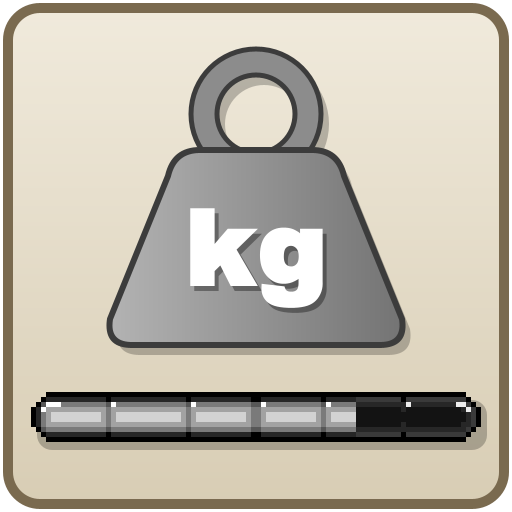
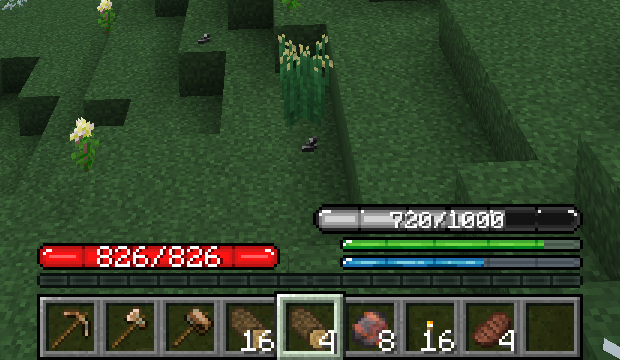

# TFC Weight Bar

**English** · [Русский](README.ru.md)

## About

This is a simple TFC addon that adds a weight points to all items in player inventory and Curios slots. If weight points exceed some amount player will receive debuff

On CurseForge: [TFC Item Weight](https://www.curseforge.com/minecraft/mc-mods/tfc-item-weight).

The bar sits above the TFC food and thirst bars and shows the weight you carry out of your capacity. It turns pink once you are Exhausted and red once you are Overburdened.

 

## Requirements

- This mod requires TerraFirmaCraft v3.2.7+ for mc 1.20
- Optional: the Curios API v5.10.0+. With it, items in Curios slots add to the weight.
- Optional: TFCCuriosWeight v1.0.0+. With it, TFC's rule for huge and very heavy items also covers Curios slots.

## Changelog

See [CHANGELOG.md](CHANGELOG.md).

## To Do List

- [x] Implement a gui/hud to display the weight bar
- [x] Add weight info to the item tooltip
- [ ] Limit the list of item ids to be checked for weight calculations

## Contributing

See [CONTRIBUTING.md](CONTRIBUTING.md) for the branch layout, how to build and what to check before opening a pull request.

## License

This mod is under the MIT License. This means that you can include it in your modpack without asking my permission.

TFC, which this mod is an addon for, is under the EUPL license. When using portions of this mod, be aware that the TFC license may apply. You can view that license on that mod page. The HUD weight bar texture is the weight bar from TFCSU (TFC Russia server mod for 1.7.10), itself a recolor of the TFC HUD bar.

TFCCuriosWeight is under the MIT License. You can view that license on that [mod page](https://github.com/koenigstag/tfc-curios-weight).

Curios, which this mod depends on, is under the LGPL. You can view that license on that mod page.
