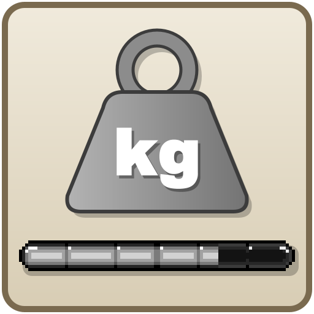
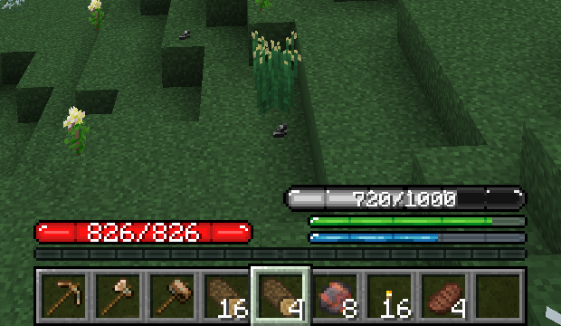

# TFC Weight Bar

[English](README.md) · **Русский**

## О моде

Простой аддон к TFC, который назначает вес всем предметам в инвентаре игрока и в слотах Curios. Если суммарный вес превышает пороговое значение, игрок получает дебафф.

На CurseForge: [TFC Item Weight](https://www.curseforge.com/minecraft/mc-mods/tfc-item-weight).

Полоса стоит над полосами еды и жажды TFC и показывает, какой вес вы несёте и сколько можете унести. В состоянии Exhausted она розовеет, в состоянии Overburdened краснеет.

 

## Требования

- Minecraft 1.21.1 на NeoForge 21.1.0+ (собрано против 21.1.265)
- TerraFirmaCraft 4.2.0+ (собрано против 4.2.12)
- Необязательно: Curios API 9.5.0+ (собрано против 9.5.1+1.21.1). С ним в вес входят предметы в слотах Curios.
- Необязательно: TFC Curios Weight 1.0.0+, собранный из его ветки 1.21.x. С ним правило TFC для огромных и очень тяжёлых предметов действует и на слоты Curios.

## История изменений

См. [CHANGELOG.ru.md](CHANGELOG.ru.md).

## Планы

- [x] Полоса веса в интерфейсе (HUD)
- [x] Информация о весе в подсказке предмета
- [ ] Ограничить список id предметов, по которым считается вес

## Участие в разработке

Схема ветвей, сборка и что проверить перед pull request — в [CONTRIBUTING.md](CONTRIBUTING.md).

## Лицензия

Мод распространяется под лицензией MIT. Это значит, что его можно включать в сборки модов, не спрашивая моего разрешения.

TFC, аддоном к которому является этот мод, распространяется под лицензией EUPL. При использовании частей этого мода учитывайте, что лицензия TFC может распространяться и на них. Её текст доступен на странице TFC. Текстура полосы веса в HUD — это полоса из TFCSU (серверный мод TFC Russia для 1.7.10), которая сама является перекраской полосы из HUD TFC.

TFCCuriosWeight распространяется под лицензией MIT. Её текст доступен на [странице мода](https://github.com/koenigstag/tfc-curios-weight).

Curios, от которого зависит этот мод, распространяется под LGPL. Текст лицензии доступен на странице Curios.
