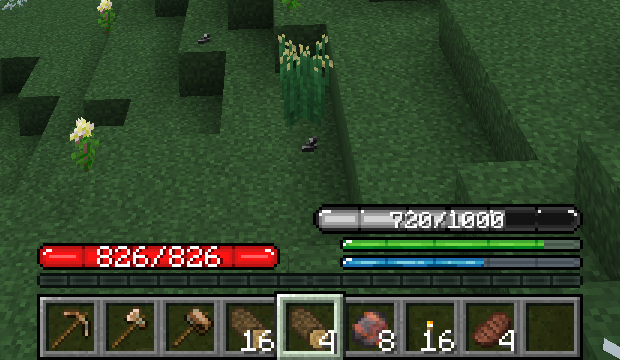

<!--
The text of the mod's page on CurseForge, kept here so it lives under git rather
than only on the site.

The CurseForge API cannot write it: its token covers uploading files and editing
a file's own metadata, nothing about the project itself. So this file is the
source of truth and the page is updated by pasting it in, under
Manage Project -> Description.

The same text is on both branches, because one page covers both game versions.

The page is called TFC Item Weight, while the repository and the mod id are
tfc_weight_bar. The names are not going to be made to match: the project id and
the slug are what the Publish workflow and every existing download point at.

The project's other fields, which are also web-only:

  Name     TFC Item Weight
  Summary  Gives every item a weight, shows your load as a HUD bar and applies
           TFC's debuffs when you carry too much (configurable).
  License  MIT
  Source   https://github.com/TFC-Russia/tfc-weight-bar
  Issues   https://github.com/TFC-Russia/tfc-weight-bar/issues
  Avatar   docs/avatar.png in this repository (512x512; CurseForge asks for 400x400)
  Images   docs/weight-bar.png, linked below from GitHub, since the page cannot
           point to a path in the repository
  Page     https://www.curseforge.com/minecraft/mc-mods/tfc-item-weight, project id 1776579
-->

# TFC Item Weight

An addon for TerraFirmaCraft that gives your inventory a carrying capacity. Every item you carry has
a weight, a bar above the TFC food bar shows how loaded you are, and carrying too much brings TFC's
own debuffs.

## Features

- **Weight for every item.** An item's weight follows its TFC weight class: very light 1, light 4,
  medium 16, heavy 32, very heavy 64 points per item. All of them are configurable.
- **Containers count too.** Backpacks and other items with an inventory, TFC vessels, and chests or
  barrels carried as items add the weight of what is inside them.
- **Curios slots count.** With the Curios API installed, items worn in Curios slots add to the
  weight. The server config can limit that to chosen slots, such as the back slot.
- **HUD bar.** A weight bar above the TFC food bar changes colour as you near your limit. It can show
  as an action bar message instead.
- **Tooltips.** Item tooltips show the item's weight, and say so when an item is too heavy to carry.
- **Debuffs.** Past 80% of your capacity you are Exhausted, and above your capacity you are
  Overburdened, both with TFC's own effects. TFC's rule for huge and very heavy items still applies,
  and with TFC Curios Weight it covers Curios slots too.
- **Health matters.** Optionally, lower health lowers how much you can carry, down to 10% of the
  maximum.

## How much can you carry?

With the default settings and full health, you stay free of debuffs while you carry less than 800
weight points: at 800 you become Exhausted, and above 1000 you are Overburdened. That is 49 logs at
16 points each, 799 pieces of charcoal at 1 point each, 199 small or poor ore pieces at 4 points
each, 49 normal ore pieces at 16 points each, or 24 rich ore pieces at 32 points each. Everything
else you carry counts too, so a full set of armour takes 256 points and a pickaxe or an axe takes 64,
and lower health lowers the limit.

## When the bar fills up

The bar tells you that you are carrying too much.
[**Pull Cart**](https://www.curseforge.com/minecraft/mc-mods/pull-cart-loom-ported) helps you move
more of it. It is a wooden cart you pull behind you by hand, or behind a horse you ride, and it takes
a chest, a crafting table, an ender chest, a furnace or a jukebox, which you open with Shift +
right-click on the cart.

A port of MC+ Cart by andykuo1, and it knows TerraFirmaCraft's item sizes.

## Customization

**Server config**, `serverconfig/tfc_weight_bar-server.toml` in the world folder: the maximum weight
(1000 by default), the Exhausted threshold, the points per weight class, the health rule, the Curios
slot types that count (`curios_slots`, every slot by default), and switches for the debuffs, the food
exhaustion and the whole system.

**Client config**, `config/tfc_weight_bar-client.toml`: whether the HUD bar is drawn, or the weight is
shown above the hotbar instead.

**Datapacks**: add an item to one of the tags `tfc_weight_bar:weight/very_light`, `light`, `medium`,
`heavy` or `very_heavy` to give it that weight in the bar without changing its TFC size or stack
size. Ore pieces and minerals are tagged this way out of the box.

## Requirements

| Minecraft | Loader | TerraFirmaCraft | Curios API (optional) | TFC Curios Weight (optional) |
|---|---|---|---|---|
| 1.20.1 | Forge 47+ | 3.2.7+ | 5.10.0+ | 1.0.0+ |
| 1.21.1 | NeoForge 21.1.0+ | 4.2.0+ | 9.5.0+ | 1.0.0+ |

Only TerraFirmaCraft is required. With the Curios API, items in Curios slots add to the weight; with
[**TFC Curios Weight**](https://www.curseforge.com/minecraft/mc-mods/tfc-curios-weight), TFC's rule
for huge and very heavy items also covers Curios slots.

## License

MIT: you can include it in your modpack without asking permission. Copyright (C) 2024-2026
koenigstag.

TerraFirmaCraft, which this is an addon for, is under the EUPL, and the Curios API is under the LGPL;
both licences are on their own mod pages. The HUD weight bar texture is the weight bar from TFCSU,
the TFC Russia server mod for 1.7.10, itself a recolour of the TFC HUD bar.

Source: [github.com/TFC-Russia/tfc-weight-bar](https://github.com/TFC-Russia/tfc-weight-bar).
